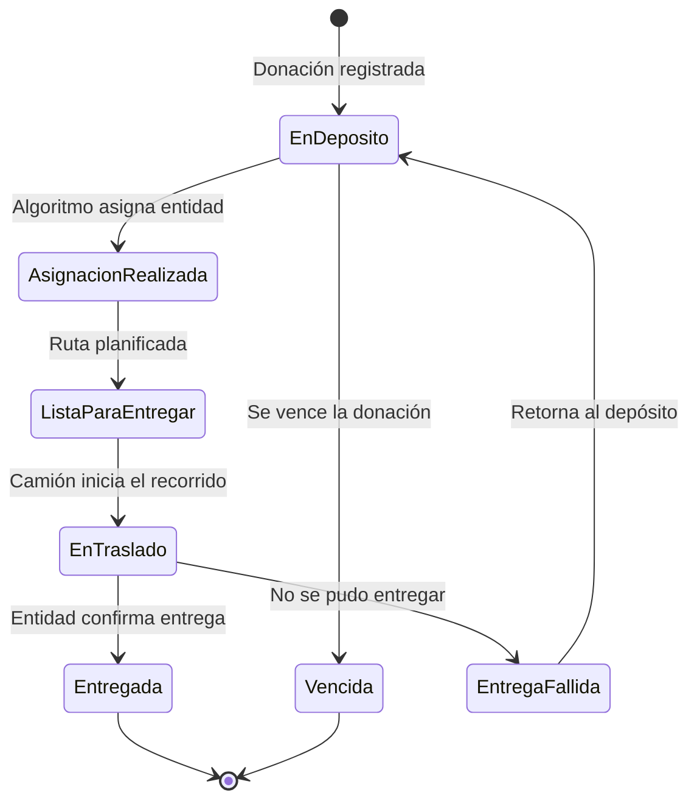

# 🎁 DonaTrack — Sistema de Gestión y Trazabilidad de Donaciones

Plataforma web para organizar, registrar y monitorear donaciones de bienes materiales, desde que llegan al depósito de la organización hasta que se entregan a entidades beneficiarias.

Trabajo Práctico Anual Integrador de la cátedra **Diseño de Sistemas de Información** (UTN FRBA, 2026). Usa como caso de estudio a **UTN Solidaria**, la iniciativa de la Subsecretaría de Asuntos Estudiantiles de la facultad.

## 🎯 Problema que resuelve

Una organización sin fines de lucro que recibe y distribuye donaciones suele tener registros duplicados y poca claridad sobre el destino de lo que recibe. DonaTrack unifica todo en un solo sistema para mejorar la distribución de recursos y fortalecer la confianza de donantes y entidades beneficiarias.

## 🏗️ Arquitectura

Arquitectura distribuida en servicios, con un cliente liviano desacoplado que consume sus APIs REST.

| Servicio | Responsabilidad |
|---|---|
| **Donaciones** | Alta, baja y modificación de donantes (humanos y jurídicos) y entidades beneficiarias, registro de donaciones con trazabilidad y auditoría de estados, importación masiva por CSV y asignación de donaciones a entidades. |
| **Logística** | Flota de camiones, planificación de rutas, seguimiento de entregas y monitoreo de camiones en tiempo real. |
| **Incentivos** | Analítica de donantes, misiones, insignias, categorías y ranking mensual. |
| **Notificaciones** | Envío por correo electrónico, SMS y WhatsApp ante los eventos relevantes del sistema. |
| **Autenticación** | Gestión de tokens de autorización desde el frontend hacia los servicios. |
| **Cliente liviano** | Interfaz web con arquitectura MVC y motor de plantillas, desacoplada de la lógica de negocio. |

## 👥 Roles y funcionalidades

- **Persona donante** (humana o jurídica): registra su cuenta, filtra sus donaciones por estado y categoría, consulta misiones e insignias, sigue en un mapa las entregas activas y recibe notificaciones.
- **Entidad beneficiaria**: registra necesidades (recurrentes y extraordinarias), ve el estado de sus donaciones, confirma la recepción cargando fotos y sigue las entregas en un mapa.
- **Persona administradora**: registra donantes y donaciones en el depósito, confirma la entidad destino de cada donación, administra los camiones, ve el ranking mensual e importa donantes desde CSV (más de 10.000 filas).
- **Chofer**: informa el inicio de su ruta.
- **Público general**: landing page, mapa de donaciones entregadas y fotos sin necesidad de login.

## 🔄 Ciclo de vida de una donación

Cada cambio de estado queda registrado para garantizar trazabilidad y auditoría. Cuando una entrega falla se registra una justificación.

## ⚙️ Aspectos técnicos destacados

- **Segmentación automática de donaciones:** una sola carga se divide en donaciones independientes agrupadas por subcategoría (y por fecha de vencimiento en bienes perecederos).
- **Matchmaking con algoritmos intercambiables:** *Compatibilidad Semántica* (coincidencia entre bienes y necesidades) y *Prioridad a sub-atendidos* (entidades con menos donaciones en el último trimestre). Proponen hasta diez entidades y se ejecutan de forma asincrónica en horarios de baja carga.
- **Necesidades recurrentes y extraordinarias:** las extraordinarias se satisfacen con donaciones parciales hasta alcanzar la cantidad requerida.
- **Sistema de incentivos con ludificación:** tres categorías (Colaborador, Sostenedor y Transformador), misiones secuenciales (racha, completitud, hábil donador, donaciones exitosas) e insignias.
- **Automatización con n8n:** al obtener una insignia se dispara un flujo que genera una imagen y publica el logro en una red social. Otro flujo programado calcula el ranking mensual.
- **Integración con planificador de rutas externo:** solicitudes en lotes (máximo 100 donaciones por ejecución), URL de *callback* para recibir el resultado y verificación de firma **HMAC SHA-256**. Las donaciones sin asignar se vuelven a planificar.
- **Notificaciones asincrónicas:** los servicios de dominio se comunican con el de Notificaciones mediante una cola de mensajes para no afectar la disponibilidad ante picos de carga.
- **Persistencia políglota:** ORM sobre MySQL para los servicios relacionales y base documental (ODM) para Logística, con desnormalización donde optimiza las lecturas.
- **Interfaz:** diseño orientado a usabilidad heurística, responsive y accesible (WCAG AA).

## 📦 Estado del proyecto

| Entrega | Contenido | Estado |
|---|---|---|
| 1 | Arquitectura y modelado en objetos, parte I y diseño de interfaz (bocetos) | ✅ Completa |
| 2 | Trazabilidad, asignación de necesidades, incentivos, notificaciones reales y exposición REST | ✅ Completa |
| 3 | Logística: planificación de rutas, integración externa y monitoreo en tiempo real | ✅ Completa |
| 4 | Persistencia (ORM / ODM) y maquetado de interfaz con HTML5 y CSS | ✅ Completa |
| 5 | Arquitectura web MVC: cliente liviano desacoplado y servicio de autenticación | ✅ Completa |
| 6 | Despliegue en la nube, observabilidad, monitoreo, rate limiting y gRPC o GraphQL | 🚧 En desarrollo |

## 🙋‍♀️ Mi aporte

Dentro del trabajo en equipo, me encargué entre otras cosas de de:

- **Servicio de Incentivos:** misiones, insignias, categorías y ranking mensual, incluyendo los flujos de automatización en n8n.
- **Servicio de Logística:** planificación de rutas mediante el patrón de *webhook/callback* con verificación de firma HMAC SHA-256.

## 🎓 Contexto académico

Cátedra Diseño de Sistemas de Información, Universidad Tecnológica Nacional (Facultad Regional Buenos Aires), 2026.
